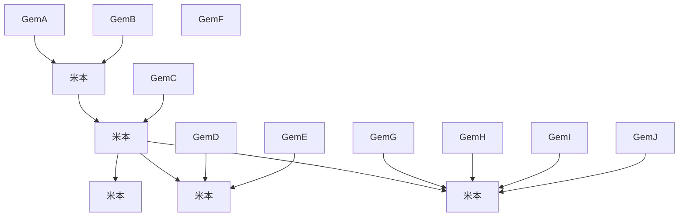

# プロジェクト企画書: 倒立振子ロボット開発

## 1. 背景

背景を深く理解してもらうために、まずは自分のキャリアを紹介する。

### 1.1　自分のキャリア

私は、PLC制御システム開発歴が5年、ソフト開発歴が1.5年の30歳である。
私はPLC制御システム開発で要件定義、基本設計、詳細設計、総合テスト、リリース対応まで幅広く経験し、最終的にPMのポジションで制御システムのリリースまで経験した。
私の最終的なキャリアの終着点はPMだと想定している一方、過去のPM経験を経て、PMとして飛躍するには現場での技術的な肌感を養わなければならないと痛感した。
その経験から、組込ソフトエンジニアに転身し、現在は車載の量産部品における組込ソフトウェア開発をしている。

### 1.2 自分のキャリアに対して、自分が感じていること

業務で組込ソフトエンジニアとして成長を感じる一方、自分は年齢の割に組込ソフトエンジニアとしての経験が不足しており、組込ソフトエンジニアとして高い市場価値を得るためには、今よりも指数関数的に成長する必要がある。
また、私は大学の専攻分野が物理工学であり、物理数学が比較的得意だと認識している。
そのため、組込ソフトエンジニアとして市場価値を高めるには、物理工学専攻で学んだ知識と組込ソフトエンジニアの経験を融合させることが自分にとって効果的だと考えている。
さらに、私は今後、MBDを用いた組込ソフトウェア開発案件にアサインされる予定になっており、MBDが私のキャリアにとって重要な要素になると予想される。

### 1.3 自分の市場価値を高めるためにどうする？

自分の市場価値を効果的に高めるには、物理工学と組込ソフトウェアとMBDの要素を持つ自己研鑽プロジェクトを立ち上げることがマストだと考えられる。
上記の背景から、私は自身のスキルアップを目的とした自己研鑽プロジェクト「倒立振子ロボット開発」を立ち上げる。

## 2. 目的

本プロジェクトは自身のスキルアップを目的とする。
具体的には、以下である。
なお、スキルアップの優先順位は高くなるほど、番号が小さくなる。

1. **組込ソフトウェア実装技術の向上**
   * マイコン（ESP32やSTM32等）への実装、タイマ割り込みによるリアルタイム性の確保、センサー（IMU）やモータのドライバ制御。
2. **制御工学の体系的理解**
   * 物理モデリング（運動方程式の導出）、状態空間モデルの構築、現代制御/古典制御アルゴリズム（PID、LQR等）の設計とシミュレーション。
3. **V字開発プロセスの流れの体験**
   * 要求定義、設計、実装、そしてそれらに対応するテストフェーズを体系的に結びつける開発手法の体験。
4. **モデルベース開発（MBD）のプロセスの体験**
   * 実機作成前にシミュレーション上で妥当性を検証するプロセス（MILS/SILS）の実践。
5. **プロジェクトの一気通貫の管理（企画～完成）**
   * 企画書の立案からシステム要件、技術要件の定義、実装、検証まで、プロの開発現場と同様の流れを体験。

## 3. 開発プロセス

開発プロセスは、組込SW開発のV字開発プロセスとMBDのV字開発プロセスを混ぜ合わせたウォーターフォール形式を採用する。
開発フェーズは以下構成になる。

1. **企画**
   * 本フェーズになる。倒立振子ロボットプロジェクトの方針を決める。
   * 成果物は企画書になる。
   * レビュアーは企画書をレビューし、承認を貰い次第、製品要件定義に移ることができる。
2. **製品要件定義**
   * 顧客になりきり、今回の倒立振子ロボットに対する製品要件を決定する。
   * 成果物は製品要件定義書になる。
   * レビュアーは製品要件定義書をレビューし、承認を貰い次第、技術要件定義に移ることができる。
3. **技術要件定義**
   * PMになりきり、製品要件を満たすための技術要件を決定する。
   * 成果物は技術要件定義書になる。
   * レビュアーは技術要件定義書をレビューし、承認を貰い次第、MBDシステム設計に移ることができる。
4. **MBDシステム設計**
   * MBDシステムエンジニアになりきり、技術要件に基づく物理モデルを設計する。
   * 成果物はシステム設計書になる。
   * レビュアーはシステム設計書をレビューし、承認を貰い次第、MBDモデル設計に移ることができる。
5. **MBDモデル実装**
   * MBDシステムエンジニアになりきり、システム設計書に基づく物理モデルを実装する。
   * 成果物は物理モデルになる。
   * レビュアーは物理モデルをレビューし、承認を貰い次第、ハードウェア組み立てに移ることができる。
6. **ハードウェア準備&組み立て**
   * MBDシステムエンジニアになりきり、システム設計書および物理モデルに基づいて、倒立振子ロボットのハードウェアを選定する。
   * MBDシステムエンジニアは、ハードウェア選定部品リストを作成する。
   * レビュアーはハードウェア選定部品リストをレビューし、承認をもらい次第、調達部が部品を購入する。
   * 今回の目的は主に組込SWおよびMBDの開発経験を積むことであるため、ハードウェアはなるべく時間をかけないようにする。したがって、マイコンは評価ボードを使用し、その他モータや筐体は既製品で揃えるものとする。
   * 部品が手元に届いたら、ロボットを組み立てる。
   * このフェーズにおける最終成果物はロボットそのものになる。
   * ロボットが組み上がり次第、組込SW基本設計に移ることができる。
7. **組込SW基本設計**
   * 組込SWエンジニアになりきり、技術要件定義書、システム設計書に基づく組込SW基本設計書を作成する。
   * 成果物は組込SW基本設計書になる。
   * レビュアーは組込SW基本設計書をレビューし、承認を貰い次第、組込SW詳細設計に移ることができる。
8. **組込SW詳細設計**
   * 組込SWエンジニアになりきり、組込SW基本設計書に基づく組込SW詳細設計書を作成する。
   * 成果物は組込SW詳細設計書になる。
   * レビュアーは組込SW詳細設計書をレビューし、承認を貰い次第、コード実装に移ることができる。
9. **組込SWコード実装**
   * 組込SWエンジニアになりきり、組込SW詳細設計書に基づくソースコードを実装する。
   * 成果物はソースコードになる。
   * レビュアーはソースコードをレビューし、承認を貰い次第、組込SW総合テストに移ることができる。
10. **制御パラメータキャリブレーション&組込SW総合テスト**
    * 組込SWエンジニアになりきり、実際のロボットの動作確認および制御パラメータの微調整を行う。
    * テストでは、ロボットの挙動が物理モデルと同じだと確かめることで、実装結果が設計仕様と同じだと証明する。
    * 成果物は総合テスト設計/実績書になる。
    * レビュアーは総合テスト設計およびテスト結果をレビューし、承認を貰ったら、本プロジェクトを完了する。

## 4. 開発メンバー構成

メンバ構成は以下の通りである。
今回はあくまで自己研鑽のため、各役割の実行者は自分自身であり、レビュアーはGeminiの機能であるGemを使用する。

## 5. 開発環境

1. MBD/システム開発
   * 物理モデルはPythonを用いること。
   * シミュレーションのモニタツールもPythonで開発すること。
2. 組込SW開発
   * Cコードで実装すること。
   * マイコンはSTマイコンを使用し、CUBE MX IDEを使うこと。
3. バージョン管理ツール
   * GitHubを使用すること。
4. プロジェクト管理ツール
   * GitHubを使用すること。

## 6. スケジュール

1. **企画**
   * 7/15までに完了させる。
2. **製品要件定義**
   * 8/15までに完了させる。
3. **技術要件定義**
   * 9/5までに完了させる。
4. **MBDシステム設計**
   * 10/10までに完了させる。
5. **MBDモデル実装**
   * 11/14までに完了させる。
6. **ハードウェア準備&組み立て**
   * 11/28までに完了させる。
7. **組込SW基本設計**
   * 12/12までに完了させる。
8. **組込SW詳細設計**
   * 1/2までに完了させる。
9. **組込SWコード実装**
   * 1/23までに完了させる。
10. **組込SW総合テスト**
    * 2/28までに完了させる。

## 7. 予算

今回は自己研鑽のため、予算に上限は特に設けない。
費用対効果を考え、総合的に判断する。
